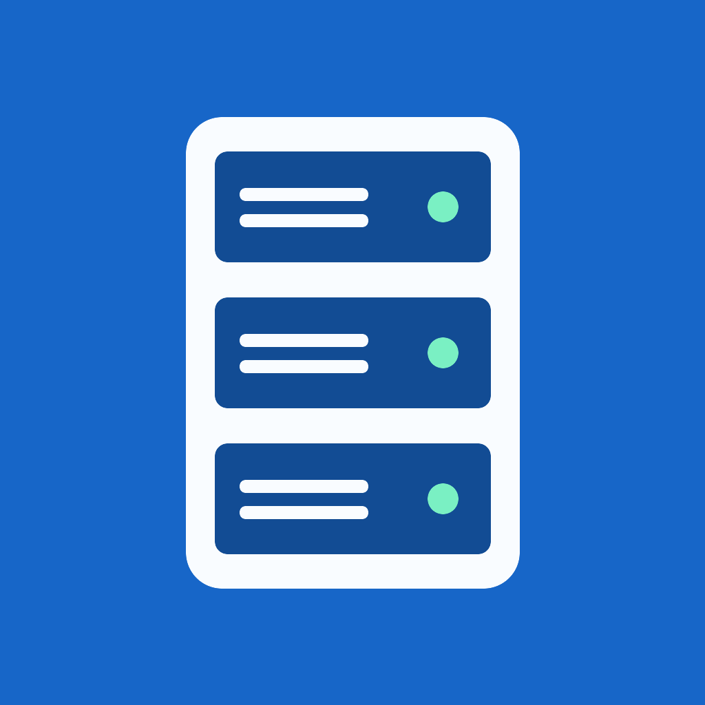
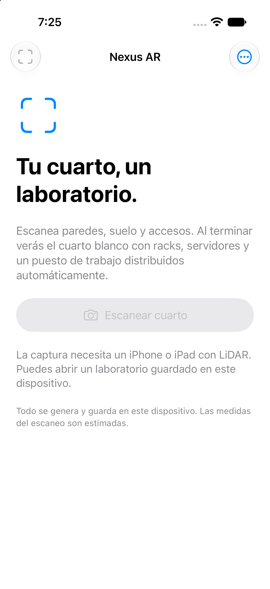
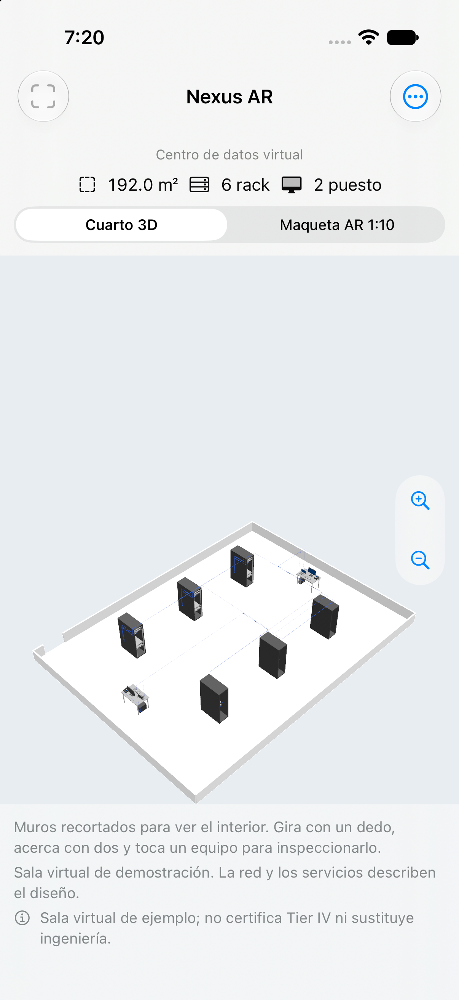
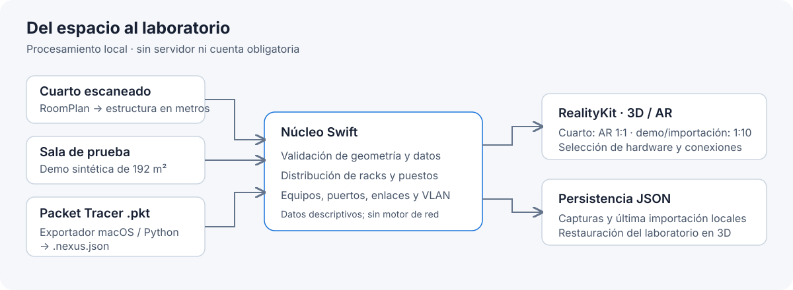

<p align="center">
  
</p>

# CISCO NEXUS AR · UNSM

**Convierte tu cuarto en un laboratorio de redes y explóralo desde el iPhone.**

Proyecto educativo de realidad aumentada: escanea paredes, suelo y accesos con RoomPlan,
genera una distribución de racks y puestos, e inspecciona equipos y conexiones en 3D o AR.
También incluye una sala virtual de prueba y un exportador local de topologías de Packet Tracer.


[Capturas](#capturas-de-la-aplicación) · [Cómo empezar](#elige-tu-punto-de-partida) · [Instalación](#instalación) ·
[Uso](#cómo-usarlo) · [Pruebas](#comprobaciones-reproducibles) · [Arquitectura](docs/ARCHITECTURE.md)

> Proyecto independiente, no oficial de Cisco. Visualiza hardware y datos de una topología;
> no ejecuta Cisco IOS, comandos CLI, routing, paquetes ni servicios de red.

## Elige tu punto de partida

| Entrada | Necesitas | Resultado |
| --- | --- | --- |
| **Sala de prueba** | App iOS o simulador de Xcode | Explorar un laboratorio 3D sin escanear una habitación. |
| **Tu cuarto** | iPhone compatible con RoomPlan y LiDAR | Generar una distribución a partir de la estructura capturada y abrir AR 1:1. |
| **Packet Tracer** | Exportador en Mac y app iPhone | Convertir un `.pkt` a `.nexus.json` e inspeccionar su topología en 3D. |

Para conocer la interfaz, empieza por la **sala de prueba**. El simulador no valida captura LiDAR ni AR física. Unity es un compañero opcional de escritorio; la app iPhone funciona sin Unity.

## Capturas de la aplicación

Capturas reales de la versión 0.3.0 en simulador iPhone. La sala mostrada es sintética;
estas imágenes no representan una captura física con LiDAR ni validan AR sobre un dispositivo.

<p align="center">
  
  &nbsp;
  
</p>

La **Plantilla Tier IV** usa una sala de ejemplo de **16 × 12 × 3,5 m**. Incluye seis racks de TI,
dos gabinetes de UPS/baterías, cuatro unidades InRow, tres puestos de operación, 46 equipos activos y 70 circuitos de red. Los patch panels desglosan los circuitos en tramos físicos. Muestra tableros, PDU, fuentes dobles y rutas eléctricas A/B.

**HomeLab Proxmox** incluye un rack de 18 U, Proxmox, NAS, copias, UPS, router, switch,
Wi-Fi, videovigilancia y dos Raspberry Pi para DNS y domótica. Se coloca a escala real
en el piso o se ajusta a un escaneo. La [guía de operación](Tools/Operations/README.md)
cubre montaje, VLAN, servicios y automatizaciones.

## Qué puedes hacer

| Función | Comportamiento |
| --- | --- |
| Escanear tu cuarto | Captura estructura, guarda el resultado y distribuye hasta seis racks y dos puestos cuando caben. |
| Explorar en 3D | Gira, acerca, restablece la cámara y enfoca un equipo al inspeccionarlo. |
| Recorrer tu cuarto en AR | Camina con la cámara activa. El plano muestra tu posición y el laboratorio permanece a escala 1:1. |
| Colocar una maqueta | Demo e importaciones ofrecen AR 1:10: apunta a una superficie y toca para colocarla. |
| Inspeccionar la red | Consulta equipos, puertos, extremos, IPv4, VLAN y configuración importada disponible. |
| Seguir un cable | Apunta a un cable o puerto y pulsa **¿Adónde va?**. El visor resalta el recorrido y muestra equipo, puerto y rack de ambos extremos. |
| Recorrer en primera persona | Camina en 3D con el control de movimiento. Modo VR en el teléfono vertical u horizontal, con vista estereoscópica opcional en horizontal. |
| Importar Packet Tracer | Envía un .pkt desde Finder al iPhone emparejado o importa un .nexus.json desde Archivos. |
| Recuperar tu trabajo | Guarda datos localmente y restaura el laboratorio activo en 3D al abrir la app. |

Las PCs y laptops abren una consola del plano y el inventario de 38 dominios. Los comandos
guardan cambios por plantilla y comprueban caminos en la VLAN. Las herramientas de Mac y Linux
preparan carpetas NAS, copias verificables y grabación RTSP. [Guía de operación](Tools/Operations/README.md)

## Instalación

### App para iPhone

<details open>
<summary><strong>Abrir el proyecto y ejecutar la app nativa</strong></summary>

Necesitas macOS con Xcode y el SDK iOS correspondiente. El proyecto usa **Swift 6** y tiene
deployment target **iOS 17**. Para escanear, usa un dispositivo físico con LiDAR compatible
con RoomPlan; la app comprueba la compatibilidad. El simulador sirve para explorar la demo
y revisar la interfaz, sin captura LiDAR ni validación de AR física.

```sh
git clone https://github.com/ArturoVela/visor_realidad_aumentada_UNSM.git
cd visor_realidad_aumentada_UNSM
open NativeCapture/NexusRoomCapture.xcodeproj
```

1. Selecciona el esquema **NexusRoomCapture**.
2. En **Signing & Capabilities**, elige tu equipo de desarrollo y ajusta el bundle ID si hace falta.
3. Selecciona tu iPhone y ejecuta con **Run**. Autoriza la cámara al iniciar el escaneo.

La app usa **SwiftUI, RoomPlan, ARKit y RealityKit**, sin paquetes externos.
El repositorio distribuye código fuente; no incluye una IPA, un instalador ni una publicación en App Store.

Para compilar sin firma para simulador:

```sh
xcodebuild \
  -project NativeCapture/NexusRoomCapture.xcodeproj \
  -scheme NexusRoomCapture \
  -configuration Debug \
  -sdk iphonesimulator \
  -destination 'generic/platform=iOS Simulator' \
  -derivedDataPath /tmp/NexusRoomCaptureDerivedData \
  CODE_SIGNING_ALLOWED=NO build
```

</details>

### Exportador Packet Tracer para Mac

<details>
<summary><strong>Preparar el conversor y su interfaz de macOS</strong></summary>

Herramienta independiente con Python 3.10 o posterior. Desde la raíz del repositorio:

```sh
cd Tools/PacketTracerExporter
python3 -m venv .venv
.venv/bin/python -m pip install -r requirements.txt
.venv/bin/python export_pkt.py mi-laboratorio.pkt -o mi-laboratorio.nexus.json
```

La carpeta de salida debe existir. El original .pkt se conserva y un destino existente
no se sustituye sin `--force`. No requiere abrir Packet Tracer ni usar un servidor.

Para compilar la interfaz nativa de macOS con el mismo entorno:

```sh
NEXUS_PYTHON_EXECUTABLE="$PWD/.venv/bin/python" sh build-mac-app.sh
open "build/Nexus Packet Exporter.app"
```

Requiere Xcode Command Line Tools y macOS 14 o posterior. La firma es ad hoc local;
la app guarda la ruta del intérprete y debe recompilarse si mueves el entorno.

[Guía del conversor y modelos compatibles](Tools/PacketTracerExporter/README.md) ·
[Guía de la app para Mac](Tools/PacketTracerExporter/README-Mac.md)

</details>

### Unity, compañero opcional

<details>
<summary><strong>Inspeccionar estructuras exportadas desde Unity</strong></summary>

Abre `Unity/` desde Unity Hub con **Unity 6000.6.9f1** y deja que se resuelvan los paquetes
del proyecto. Incluye URP y el importador **Nexus → Importar cuarto JSON…** para inspeccionar
la estructura exportada. **Nexus → Verificar importador** ejecuta su comprobación interna.
Unity no es necesario para ejecutar la app iPhone y no renderiza su vista móvil.

</details>

## Cómo usarlo

### Mi cuarto → laboratorio a escala real

1. Pulsa **Escanear** y recorre paredes, suelo y accesos.
2. Pulsa **Terminar y generar**. La estructura se guarda antes de calcular la distribución.
3. En **Recorrer en AR**, camina con la cámara y consulta tu posición en el plano. Recorre la sala hasta guardar su referencia AR.
4. Apunta a un cable o puerto y pulsa **¿Adónde va?** para seguirlo. Toca un equipo para abrir su ficha.
5. Al volver al cuarto, abre **Recorrer en AR** y apunta a las mismas zonas hasta recuperar la posición.

### Plantilla Tier IV → maqueta o cuarto real

1. Abre **Más opciones → Plantillas → Plantilla Tier IV** para explorar racks, energía y climatización. En **Plantillas**, **Infraestructura y pruebas** abre el inventario y la comprobación de camino de los tres PCs.
2. Escanea desde la plantilla o elige **Cuarto y archivos → Aplicar plantilla al cuarto** si ya tienes un escaneo. Se necesita un área libre de 14,6 × 10,8 m con margen a paredes, 3,1 m de altura y una abertura reconocida hacia operación. La app preserva las dimensiones del equipo y mantiene el escaneo si la plantilla no cabe.
3. En el cuarto aplicado, **Recorrer en AR** conserva las paredes y el suelo reconstruidos en tono gris. Desde la sala virtual sigue disponible **Maqueta AR 1:10** para visualizar el conjunto a pequeña escala.

### Packet Tracer → laboratorio importado

Con la [acción de Finder configurada](Tools/PacketTracerExporter/README-Mac.md), haz clic derecho
en un .pkt y elige **Servicios → Enviar a Nexus Home**. Abre **Más opciones → Laboratorios guardados**
y busca en **Recibidos del Mac**. También puedes elegir un .nexus.json en **Importar topología exportada**.

Nexus AR monta una sala 3D con puestos y racks agrupados según las áreas y conexiones de Packet Tracer.
El archivo conserva el plano original, los modelos, las interfaces, el tipo de cable y la configuración
cuando están disponibles. Las fichas identifican el hardware de referencia que usa la escena.
Los cinco ejemplos de `docs/archivos_pkt/` proceden de [PKT-Projects de 0xknoty](https://github.com/0xknoty/PKT-Projects).

## Arquitectura



| Directorio | Contenido |
| --- | --- |
| [`NativeCapture/Sources/`](NativeCapture/Sources/) | App SwiftUI, captura, geometría, distribución, topología y render RealityKit. |
| [`NativeCapture/Tests/`](NativeCapture/Tests/) | Checks ejecutables de estructura, distribución, topología e importación. |
| [`Tools/PacketTracerExporter/`](Tools/PacketTracerExporter/) | Conversor Python, interfaz AppKit, pruebas y licencia GPL independiente. |
| [`Unity/`](Unity/) | Proyecto opcional para inspección de estructuras en escritorio. |
| [`docs/`](docs/) | Arquitectura, criterios de UX e imágenes del proyecto. |

Los datos permanecen en el dispositivo: estructuras en `Documents/Captures`, última importación
en `Documents/Labs/last-import.nexus.json` y estado diagnóstico en `Documents/Diagnostics`.
Los diagnósticos no guardan fotografías ni coordenadas del cuarto. No hay servidor, cuentas
ni sincronización obligatoria.

## Referencias de hardware

El [catálogo de hardware](NativeCapture/Sources/HardwareCatalog.swift) incluye fuentes oficiales
Cisco y Dell. Los modelos 3D son representaciones exteriores aproximadas, no planos CAD certificados.

<details>
<summary><strong>Ver modelos de referencia y equivalencias de Packet Tracer</strong></summary>

| Referencia | Tipo |
| --- | --- |
| Cisco R42612 | Rack pasivo de 42 U |
| Cisco Catalyst 2960-24TT-L | Switch de acceso |
| Cisco Catalyst 3560-24PS | Switch multicapa |
| Cisco ISR 1941 / ISR 2911 | Routers |
| Cisco ASA 5505 | Firewall |
| Cisco UCS C220 M5 SFF | Servidor de rack de 1 U |
| Cisco IP Phone 7960G | Teléfono IP |
| Dell OptiPlex 7010 Mini Tower (2012) | Computadora |
| Dell Latitude 5420 | Laptop |

El Catalyst 3650-24PS y el ISR 2811 también tienen ficha y modelo 3D. Los equipos genéricos,
como `Server-PT`, `PC-PT` y `Laptop-PT`, tienen formas ilustrativas para su tipo.

</details>

## Comprobaciones reproducibles

Desde la raíz del repositorio, ejecuta los cuatro checks Swift:

```sh
cd NativeCapture
xcrun swiftc Sources/RoomStructure.swift Tests/RoomStructureCheck.swift -o /tmp/nexus-room-check
/tmp/nexus-room-check

xcrun swiftc Sources/RoomStructure.swift Sources/HardwareCatalog.swift Sources/LabLayout.swift Sources/LabTopology.swift Sources/LabARAssembly.swift Tests/LabLayoutCheck.swift -o /tmp/nexus-layout-check
/tmp/nexus-layout-check

xcrun swiftc Sources/RoomStructure.swift Sources/HardwareCatalog.swift Sources/LabLayout.swift Sources/LabTopology.swift Sources/LabARAssembly.swift Tests/LabTopologyCheck.swift -o /tmp/nexus-topology-check
/tmp/nexus-topology-check

xcrun swiftc Sources/RoomStructure.swift Sources/HardwareCatalog.swift Sources/LabLayout.swift Sources/LabTopology.swift Sources/LabARAssembly.swift Sources/LabImport.swift Tests/LabImportCheck.swift -o /tmp/nexus-import-check
/tmp/nexus-import-check
```

Para comprobar el exportador después de preparar su entorno, desde la raíz:

```sh
cd Tools/PacketTracerExporter
.venv/bin/python -B test_export.py
```

Los checks cubren geometría, contención, accesos, determinismo, JSON, puertos, medios, IPv4,
VLAN, importaciones inválidas y escritura atómica. El check Python genera una práctica propia
temporal y prueba contenedores .pkt modernos y legacy.

**Registro de verificación de la versión 0.3.0:** build de simulador y los cinco checks anteriores aprobados.
Las pruebas físicas de Maqueta AR 1:10 y las mediciones comparativas de precisión/rendimiento
siguen pendientes; consulta la [documentación nativa](NativeCapture/README.md) para el detalle de QA.

## Límites y datos que debes revisar

- **Medición:** RoomPlan estima dimensiones. No hay editor manual ni precisión métrica garantizada;
  geometrías curvas, inclinadas o incompletas pueden producir avisos o errores.
- **Distribución:** heurística determinista, no certificación de una instalación. El blanco superpuesto
  puede ocultar muebles en pantalla que siguen físicamente presentes.
- **AR al reiniciar:** abre el cuarto guardado en 3D y elige **Recorrer en AR**. El iPhone recupera el
  origen si guardó un mapa y reconoce el cuarto. Escaneos anteriores sin mapa requieren capturar de nuevo.
- **Cableado 3D:** las rutas ilustran el diseño de red. Los enlaces sin una ruta de bandeja válida
  permanecen disponibles en **Red y conexiones**.
- **Modo VR:** la vista para gafas divide la escena por ojo en horizontal. En ambos formatos se
  avanza con el control de movimiento y se puede cambiar la mirada por gesto o con el sensor del teléfono.
- **Importación:** hasta 8 MiB de JSON, 96 equipos, 192 enlaces y 64 VLAN. Los JSON antiguos de
  sala virtual admiten hasta 12 racks y 24 puestos.
  El conversor limita .pkt a 16 MiB y XML descomprimido a 32 MiB. Modelos o medios no admitidos,
  actividades .pka y evaluaciones producen error.
- **Configuración importada:** el JSON puede conservar contraseñas presentes en el laboratorio original.
  Revisa y elimina datos sensibles antes de compartirlo o publicarlo.
- **Tier IV:** la demo describe conceptos de energía/refrigeración A/B; no constituye un diseño
  constructivo ni una certificación. Las medidas de la demo no son una exigencia normativa.

Capturas privadas, entornos Python, cachés y resultados de compilación quedan excluidos de Git.

## Documentación y licencia

- [App nativa y contratos JSON](NativeCapture/README.md).
- [Arquitectura y flujo de datos](docs/ARCHITECTURE.md).
- [Definición del producto](PRODUCT.md) y [criterios de UX](docs/UX_BRIEF.md).
- [Exportador Packet Tracer](Tools/PacketTracerExporter/README.md).

`Tools/PacketTracerExporter/` se distribuye bajo **GPL-3.0-or-later**; consulta su
[LICENSE](Tools/PacketTracerExporter/LICENSE). Usa `packet-tracer-pkt-format==0.4.1`
de aacanadaa, con la misma licencia. La herramienta se comunica por JSON y sus dependencias
Python no se incorporan al ejecutable iPhone.

El resto del repositorio no declara una licencia general de reutilización. Las marcas y nombres
de productos pertenecen a sus respectivos titulares; este proyecto no está afiliado a Cisco ni Dell.

[Ideas para el visor y los laboratorios](docs/IDEAS-LABORATORIOS.txt)
